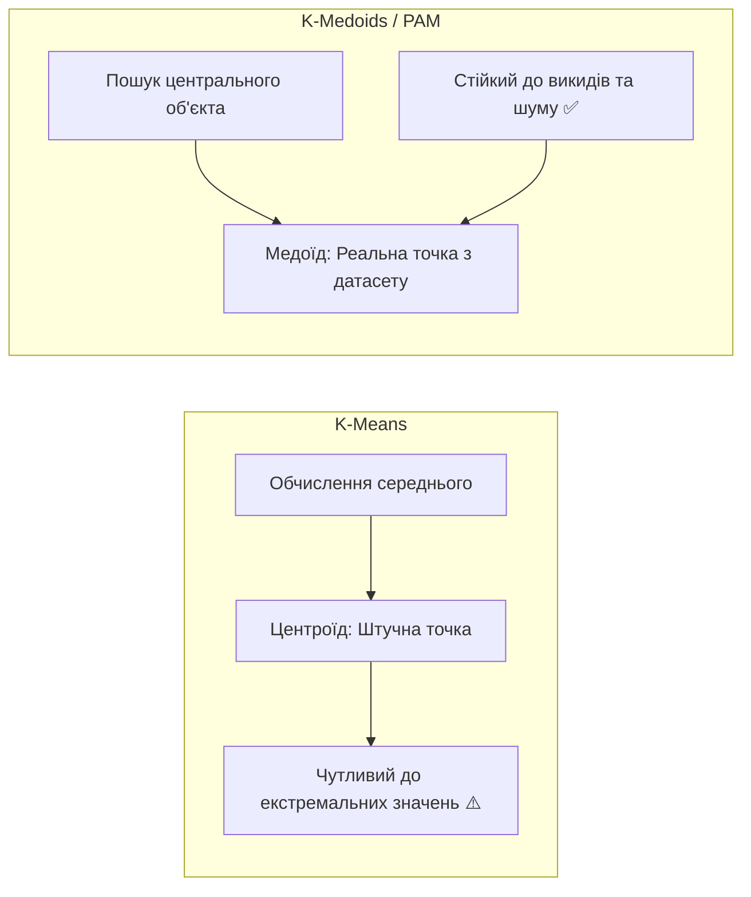
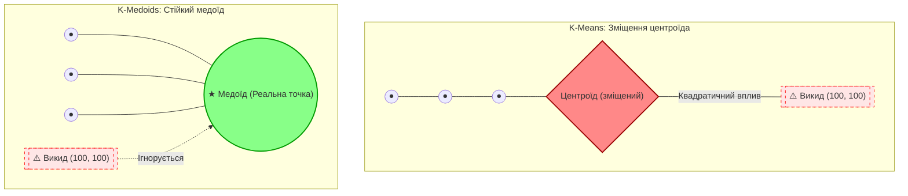

# K-Medoids (PAM) проти K-Means: чому медоїди стійкіші до викидів.

## 1. Вступ та актуальність

Під час вирішення задач кластеризації ми майже завжди стикаємося з однією і тією ж проблемою: **сирі дані рідко бувають ідеальними**. У реальних датасетах майже завжди є шум, помилки вимірювань або крайні значення — те, що ми називаємо **викидами (outliers)**.

>[!note]
Найпопулярніший алгоритм кластеризації — **K-Means** — відомий своєю швидкістю, але він має серйозну «ахіллесову п'яту»: він критично чутливий до таких викидів.

>[!important]
Сьогодні ми розберемо, чому алгоритм **K-Medoids (зокрема його класична реалізація PAM — Partitioning Around Medoids)** є значно стійкішим до аномалій і коли варто обирати саме його.

---

## 2. Природа центрів: Центроїд проти Медоїда

>[!warning]
Основна відмінність між цими підходами полягає в тому, **що саме вважається центром кластера**.

>[!note]
* **У K-Means центрами є центроїди.** Центроїд — це штучно обчислена точка, яка є арифметичним середнім усіх точок кластера. У математичному сенсі середнє значення за визначенням "тягнеться" в бік крайніх відхилень.
* **У K-Medoids центрами є медоїди.** Медоїд — це **фактичний, реальний об'єкт** із нашого датасету, який розташований найближче до геометричного центру групи (мінімізує суму відстаней до всіх інших точок кластера).
> 
> 

---

### 3. Математична причина стійкості

>[!important] 
Чому саме медоїд не піддається впливу аномалій? Тут діють два ключові чинники:

1. **Метрика відстані та квадратичні штрафи:**
K-Means зазвичай мінімізує суму *квадратів* евклідових відстаней ($SSE$). Якщо точка лежить далеко (наприклад, на відстані 100 одиниць від групи), її внесок у помилку зростає у квадрат — тобто стає рівним $10\ 000$. Щоб зменшити цю гігантську помилку, алгоритм змушений зміщувати центроїд у бік викиду.
K-Medoids (PAM) оперує *абсолютними* відстанями (або довільною матрицею дисиміляції). Для нього далека точка створює лінійну, а не квадратичну помилку.
2. **Захист від «порожніх» центрів:**
Оскільки медоїд — це обов'язково існуюча точка, алгоритм обирає об'єкт із найщільнішої області даних. Викид може стати медоїдом лише в одному випадку: якщо він утворює власний окремий кластер із декількох точок.

---

### 4. Візуалізація впливу викиду

---

### 5. Порівняння алгоритмів (За та Проти)

| Характеристика | K-Means | K-Medoids (PAM) |
| --- | --- | --- |
| **Центр кластера** | Штучний (середнє) | Реальний об'єкт датасету |
| **Стійкість до викидів** | ❌ Низька (сильне зміщення) | ✅ Висока |
| **Типи даних** | Лише безперервні числові | Будь-які (категоріальні, текстові, графів) |
| **Обчислювальна складність** | $O(t \cdot k \cdot n)$ — Дуже швидкий | $O(k \cdot (n-k)^2)$ — Повільніший на великих $n$ |

---

### 6. Висновки та практичні рекомендації
>[!tip]
> Підсумовуючи:
> * **Обирається K-Means**, якщо наявний великий обсяг даних (мільйони записів), дані попередньо очищені від аномалій і важлива швидкість обчислень.
> * **Обирається K-Medoids (PAM)**, якщо дані містять шум, потенційні викиди, або якщо ви працюєте з нечисловими метриками відстані (наприклад, відстань Мангеттена, відстань Левенштейна для тексту тощо).

---
>[!important] «Якщо в кімнаті з 5 студентами опиниться один мільярдер, середня зарплата в кімнаті буде декілька мільйонів (K-Means), але медіанний студент все одно матиме звичайну стипендію (K-Medoids)»*.