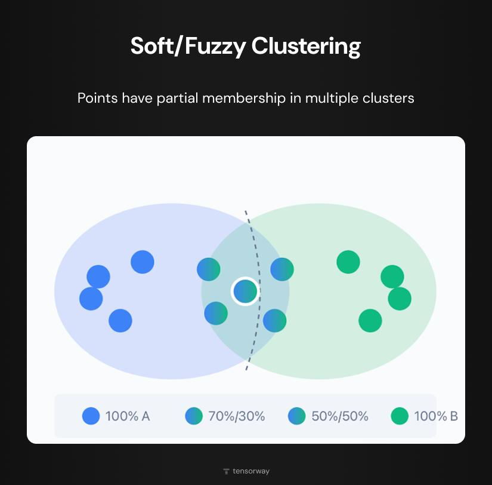
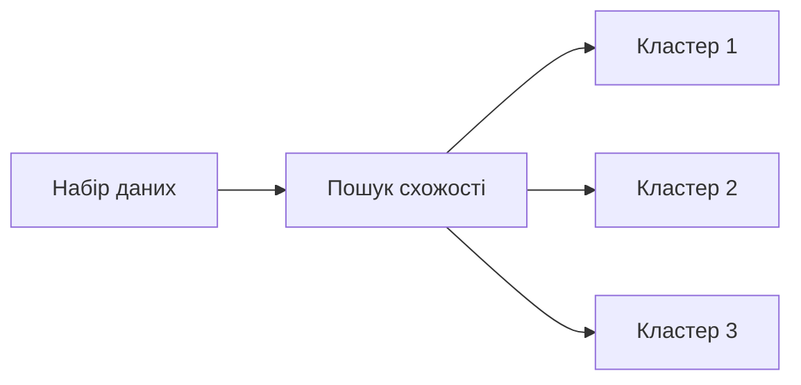
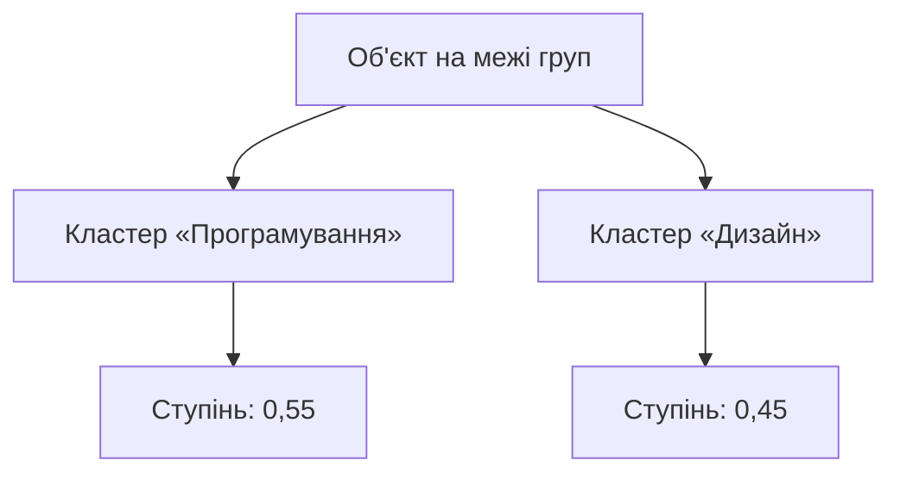
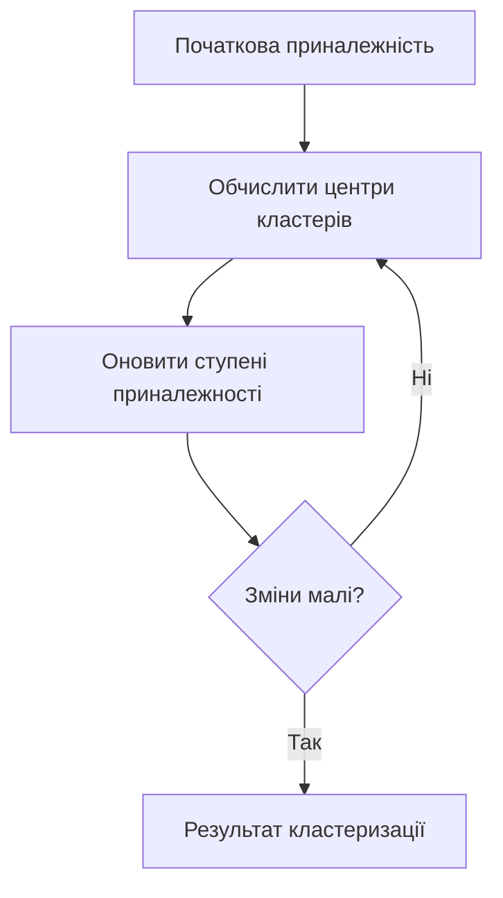

<style>
/* Фон в тематике Machine Learning */
body {
    background-image:
        linear-gradient(
            rgba(3, 8, 22, 0.84),
            rgba(3, 8, 22, 0.92)
        ),
        url("background.jpeg");

    background-size: cover;
    background-position: center;
    background-repeat: no-repeat;
    background-attachment: fixed;

    color: #e6edf3;
}

/* Прозрачный фон области предпросмотра */
.markdown-preview.markdown-preview {
    background: transparent;
    color: #e6edf3;
}

/* Заголовки */
.markdown-preview h1 {
    color: #70b7ff;
    border-bottom: 1px solid #315b91;
    padding-bottom: 10px;
}

.markdown-preview h2,
.markdown-preview h3 {
    color: #8cc8ff;
}

/* Горизонтальные линии */
.markdown-preview hr {
    border: none;
    border-top: 1px solid rgba(90, 160, 255, 0.4);
}

/* Блоки кода */
.markdown-preview pre {
    background: rgba(5, 15, 35, 0.85);
    border: 1px solid rgba(65, 145, 255, 0.45);
    border-radius: 10px;
    padding: 14px;
}

/* Таблицы */
.markdown-preview table {
    background: rgba(5, 15, 35, 0.85);
    border-collapse: collapse;
}

.markdown-preview th {
    color: #75c5ff;
    background: rgba(30, 75, 130, 0.35);
}

.markdown-preview th,
.markdown-preview td {
    border: 1px solid rgba(100, 160, 255, 0.35);
    padding: 8px 12px;
}

/* Изображения */
.markdown-preview img {
    border-radius: 10px;
    max-width: 100%;
    height: auto;
}

/* Ссылки */
.markdown-preview a {
    color: #70c7ff;
}

/* Цитаты */
.markdown-preview blockquote {
    border-left: 4px solid #657cff;
    background: rgba(12, 25, 55, 0.75);
    padding: 10px 16px;
    border-radius: 0 8px 8px 0;
}
</style>


# Fuzzy C-Means: нечітка кластеризація та ступінь приналежності об'єктів⚛️

**Головна ідея:** об'єкт не обов’язково належить лише до одного кластера — він може належати до кількох, але з різним ступенем.

---

## 1. Що таке Fuzzy C-Means?💠

**Fuzzy C-Means (FCM)** — алгоритм машинного навчання без учителя, який групує схожі дані. На відміну від звичайної кластеризації, він не просто обирає для точки один кластер, а обчислює **ступінь її приналежності до кожного кластера**.



Назва підказує принцип:
- **Fuzzy** — нечіткий: межі кластерів не обов’язково різкі.
- **C-Means** — формує *C* кластерів і обчислює їхні центри (середні).

## 2. Що таке кластеризація?♻️

**Кластеризація** — це групування об’єктів за схожістю без заздалегідь заданих правильних відповідей.
Наприклад, сервіс може згрупувати покупців за поведінкою, а алгоритм аналізу фото — пікселі за кольором.



У звичайному **K-Means** кожна точка зрештою потрапляє до одного кластера. Fuzzy C-Means дозволяє описати й невизначеність на межі груп.

## 3. Що таке нечітка кластеризація?🔗

Уявімо студентів, яких групують за інтересами: програмування та дизайн. Частина студентів займається лише програмуванням, інша — дизайном, а хтось однаково цікавиться обома напрямами.

Замість примусового вибору однієї групи FCM може надати такому студентові **0,55 приналежності до «програмування» і 0,45 — до «дизайну»**. Це не ймовірність і не оцінка здібностей — це числовий показник відносної приналежності, обчислений моделлю.




*Насолоджуюся працею над доповіддю в 22:00 як справжній стоїк*

## 4. Ступінь приналежності об'єктів📐

Ступінь приналежності — число від **0 до 1**:
- **0,00** — об’єкт майже не належить до кластера;
- **0,50** — помірна приналежність;
- **0,95** — дуже сильна приналежність.

Для кожного об’єкта FCM сума ступенів приналежності до всіх кластерів дорівнює **1**. Якщо кластерів два, можливий приклад:

| Об'єкт | Програмування | Дизайн |
|---|---:|---:|
| A | 0,95 | 0,05 |
| B | 0,55 | 0,45 |
| C | 0,10 | 0,90 |

**Схематична діаграма приналежності об'єкта B:**

```text
Програмування  ███████████░░░░░░░░  0,55
Дизайн         █████████░░░░░░░░░░  0,45
               0                   1
```

Чим ближче об’єкт до центру кластера, тим зазвичай вищою є його приналежність до нього. На межі груп значення можуть бути ближчими одне до одного.

## 5. Як працює механізм Fuzzy C-Means?

1. **Задаємо** кількість кластерів *C*.
2. **Ініціалізуємо** ступені приналежності об’єктів.
3. **Обчислюємо центри** кластерів з урахуванням приналежності точок.
4. **Перераховуємо приналежність:** близькі до центру точки отримують більший ступінь.
5. **Повторюємо** кроки, доки зміни не стануть достатньо малими.



## 6. Підсумок✅

**Fuzzy C-Means не змушує кожен об’єкт обирати лише одну групу.** Він показує, наскільки об’єкт відповідає кожному кластеру. Це корисно, коли дані перетинаються, а межі між групами неочевидні.

**Запам’ятай:** K-Means — «до якої групи належиш?», а Fuzzy C-Means — «наскільки ти належиш до кожної групи?»


