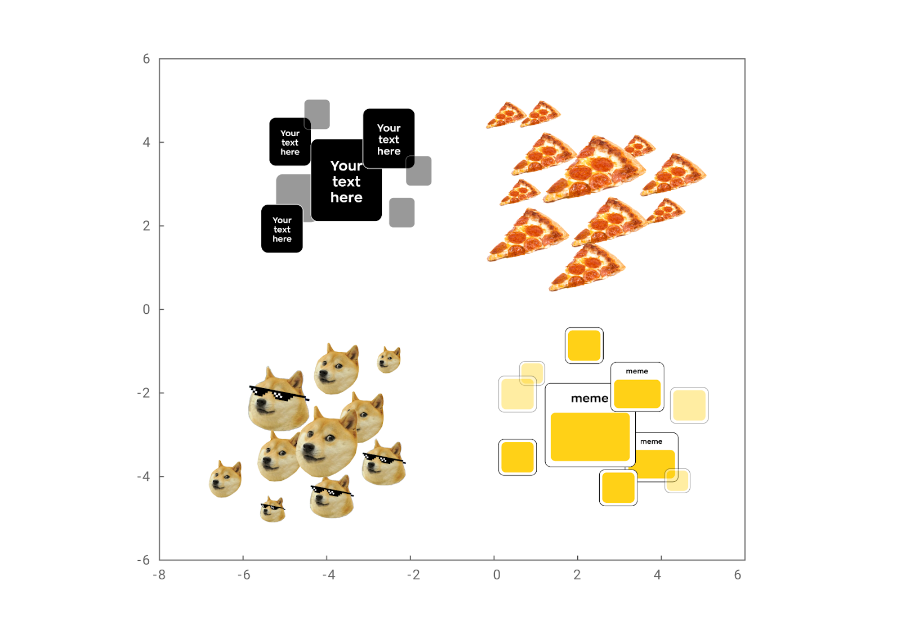
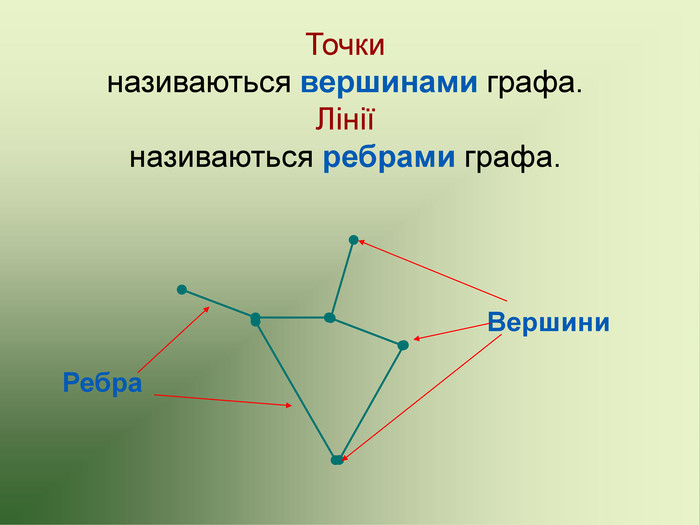

#  
 Спектральна кластеризація та кластеризація на основі графів (affinity propagation).  

<!-- _footer: "Курсант 236 н.г. солдат Стембковський" -->

---

# 1. Кластеризація
### **Кластеризація** — це метод машинного навчання, який автоматично об’єднує схожі об’єкти в групи, що називаються кластерами.
 
  
 
#### Наприклад, комп’ютер може проаналізувати тисячу фотографій і розподілити їх на групи за схожістю: коти, собаки та птахи.

 ---

 --- 

#### Кластеризацію використовують для аналізу текстів, зображень, соціальних мереж, поведінки користувачів і мережевих подій.

#### Головна мета кластеризації — знайти закономірності та групи в даних без попереднього визначення класу кожного об’єкта.

---

# 2. Графи та їхнє використання
### **Граф** — це математична структура, яка складається з вершин і ребер.
 -  Вершини представляють об’єкти.
 -  Ребра показують зв’язки між об’єктами.
 - Вага ребра показує силу зв’язку або ступінь схожості.

#### Наприклад, у соціальній мережі вершинами можуть бути користувачі, а ребрами — їхні зв’язки.

 
Графи допомагають визначати, які об’єкти тісно пов’язані між собою. Якщо об’єкти мають багато спільного, між ними можна встановити сильніший зв’язок.

У кластеризації графи використовують для пошуку груп об’єктів, які мають сильніші зв’язки всередині групи, ніж між різними групами.

---

---
# 3. Спектральна кластеризація

### **Спектральна кластеризація** (Spectral Clustering) — це алгоритм машинного навчання, який використовує графи, матриці та їхні математичні властивості для пошуку груп схожих об’єктів.

#### На відміну від простих методів, які переважно орієнтуються на відстані між об’єктами, спектральна кластеризація може враховувати структуру зв’язків між ними.

---

## Як працює спектральна кластеризація?
 1. Алгоритм визначає схожість між об’єктами.
 2. На основі схожості створюється граф.
 3. Алгоритм будує математичне представлення графа за допомогою матриць.
 4. Використовуються власні значення та власні вектори матриці Лапласіана для аналізу структури графа.
 5. Об’єкти розподіляються на кластери.

#### Головна особливість цього методу — здатність знаходити групи складної форми, які важко розділити деякими іншими алгоритмами.

---
# 4. Affinity Propagation

### **Affinity Propagation** — це алгоритм кластеризації, який визначає представників кластерів серед самих об’єктів, використовуючи оцінки схожості та обмін повідомленнями між об’єктами.

 

Особливість алгоритму полягає в тому, що представниками груп стають реальні об’єкти з початкового набору даних.

---

# Як працює Affinity Propagation?
 1. Алгоритм обчислює схожість між об’єктами.
 2. Об’єкти обмінюються математичними повідомленнями.
 3. Алгоритм оцінює, які об’єкти найкраще підходять на роль представників.
 4. Визначаються представники кластерів.
 5. Інші об’єкти розподіляються між відповідними групами.

---

### Алгоритм використовує два основні типи повідомлень.

 

### **Responsibility** (відповідальність) — показує, наскільки добре певний об’єкт підходить на роль представника для іншого об’єкта порівняно з іншими кандидатами.

 

### **Availability** (доступність) — показує, наскільки доречно обрати певний об’єкт представником з урахуванням підтримки інших об’єктів.

 

Ці повідомлення багаторазово оновлюються, поки алгоритм не визначить представників кластерів.

---

# Висновок

### **Спектральна кластеризація** та **Affinity Propagation** — це алгоритми машинного навчання, які допомагають групувати схожі дані. Вони використовують математичні обчислення та зв’язки між об’єктами. 
### Ці методи застосовують для аналізу даних, виявлення закономірностей і пошуку підозрілої активності в комп’ютерних мережах.