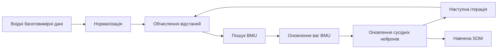
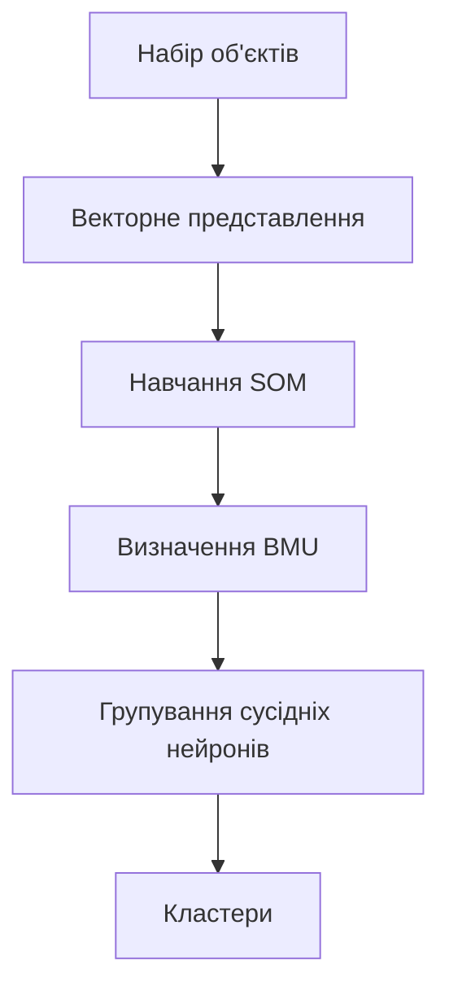
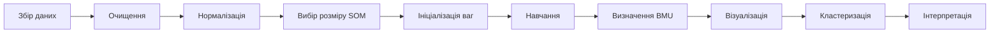

# Самоорганізаційні карти Кохонена (SOM): кластеризація та зменшення розмірності

## Вступ

Самоорганізаційні карти Кохонена (**Self-Organizing Maps, SOM**) — це різновид нейронних мереж без учителя, призначений для аналізу багатовимірних даних. Основними завданнями SOM є **кластеризація, зменшення розмірності та візуалізація структури даних**.

Головна особливість методу полягає в тому, що багатовимірний простір даних відображається на карту меншої розмірності, зазвичай двовимірну. При цьому схожі об'єкти розташовуються на карті близько один до одного.

---

## 1. Принцип роботи SOM

Кожен нейрон карти має власний ваговий вектор:

$$
w_i=(w_{i1},w_{i2},...,w_{in})
$$

Вхідний об'єкт описується вектором:

$$
x=(x_1,x_2,...,x_n)
$$

Для кожного вхідного вектора знаходиться нейрон, ваговий вектор якого найбільш подібний до вхідних даних. Він називається **нейроном-переможцем (Best Matching Unit, BMU)**.

Найчастіше подібність визначається за евклідовою відстанню:

$$
d(x,w_i)=\sqrt{\sum_{j=1}^{n}(x_j-w_{ij})^2}
$$

Нейрон із мінімальною відстанню стає BMU.

### Схема роботи



---

## 2. Навчання карти

Після визначення BMU його ваги та ваги сусідніх нейронів наближаються до поточного вхідного вектора:

$$
w_i(t+1)=w_i(t)+\alpha(t)h_{i,b}(t)[x-w_i(t)]
$$

де:

- $\alpha(t)$ — швидкість навчання;
- $h_{i,b}(t)$ — функція сусідства;
- $x$ — поточний вхідний вектор;
- $w_i$ — ваговий вектор нейрона;
- $b$ — нейрон-переможець.

З часом швидкість навчання та радіус сусідства зазвичай зменшуються. У результаті карта поступово адаптується до структури даних.

### Схема оновлення сусідства

```text
                 ○
             ○   ○   ○
         ○   ○   ★   ○   ○
             ○   ○   ○
                 ○

★ — BMU
○ — нейрони, ваги яких також оновлюються
```

---

## 3. Топологія SOM

Нейрони зазвичай розташовуються у вигляді регулярної сітки:

- прямокутної;
- шестикутної.

Наприклад, карта 10 × 10 містить 100 нейронів.

Важливою властивістю SOM є **збереження топології**: подібні об'єкти зазвичай потрапляють у близькі області карти, а сильно відмінні — у віддалені області.

### Приклад карти

```text
┌────┬────┬────┬────┬────┐
│ A  │ A  │ A  │ B  │ B  │
├────┼────┼────┼────┼────┤
│ A  │ A  │ B  │ B  │ B  │
├────┼────┼────┼────┼────┤
│ A  │ B  │ B  │ C  │ C  │
├────┼────┼────┼────┼────┤
│ D  │ D  │ C  │ C  │ C  │
├────┼────┼────┼────┼────┤
│ D  │ D  │ D  │ C  │ C  │
└────┴────┴────┴────┴────┘

A, B, C, D — умовні групи подібних об'єктів
```

---

## 4. SOM для кластеризації

Кластеризація — це автоматичний поділ об'єктів на групи за принципом подібності.

Після навчання кожен об'єкт прив'язується до свого BMU. Об'єкти, які потрапили до одного або сусідніх нейронів, можуть утворювати кластер.

### Процес кластеризації



SOM може застосовуватися для:

- сегментації клієнтів;
- аналізу документів;
- розпізнавання образів;
- виявлення аномалій;
- аналізу медичних показників;
- аналізу мережевого трафіку;
- дослідження складних технічних і військових даних.

---

## 5. SOM як метод зменшення розмірності

Одне з головних призначень SOM — представлення багатовимірних даних на карті меншої розмірності.

Наприклад:

```text
Багатовимірний простір
        │
        │  50 параметрів
        ▼
┌───────────────────────┐
│       SOM             │
│   10 × 10 нейронів    │
└───────────────────────┘
        │
        ▼
Двовимірна карта
```

Таким чином, дані з десятками або сотнями параметрів можна представити у вигляді двовимірної карти.

Це полегшує:

- візуальний аналіз;
- пошук груп;
- пошук аномалій;
- визначення взаємозв'язків;
- інтерпретацію багатовимірних даних.

---

## 6. U-Matrix

Для аналізу карти часто використовується **U-Matrix (Unified Distance Matrix)**.

Вона відображає відстані між сусідніми нейронами SOM.

Умовно:

- мала відстань → схожа область;
- велика відстань → можлива межа між кластерами.

### Концептуальна схема U-Matrix

```text
Низька відстань       Висока відстань
   ░ ░ ░                 █ █
   ░ ░ ░                 █ █
   ░ ░ ░      ███        █ █
   ░ ░ ░      ███        █ █
```

Тому U-Matrix допомагає візуально визначати межі між кластерами.

---

## 7. Компонентні карти

Ще один спосіб аналізу SOM — **component planes**, або компонентні карти.

Кожна така карта показує значення окремої ознаки на всій SOM.

Наприклад, для технічного об'єкта можна окремо відобразити:

```text
        SOM
 ┌─────────────────┐
 │  Маса            │
 │  Швидкість       │
 │  Дальність       │
 │  Потужність      │
 │  Захищеність     │
 └─────────────────┘
```

Порівняння компонентних карт дозволяє визначати взаємозв'язки між ознаками.

---

## 8. Переваги SOM

1. **Навчання без учителя** — не потрібні заздалегідь задані класи.
2. **Зменшення розмірності** — багатовимірні дані відображаються на 2D-карті.
3. **Візуалізація** — результати легко представити графічно.
4. **Збереження топології** — схожі об'єкти розташовуються поруч.
5. **Пошук прихованих закономірностей** — можна виявляти структуру, неочевидну у вихідних даних.
6. **Виявлення аномалій** — нетипові об'єкти можуть формувати ізольовані області.

---

## 9. Недоліки SOM

До основних обмежень належать:

- необхідність вибору розміру карти;
- залежність результату від параметрів навчання;
- чутливість до масштабу ознак;
- можливе нечітке розділення кластерів;
- потреба у додатковому аналізі для остаточного визначення кластерів.

Перед навчанням дані зазвичай **нормалізують або стандартизують**, щоб ознаки з великими числовими значеннями не домінували над іншими.

---

## 10. Порівняння з іншими методами

| Метод | Кластеризація | Зменшення розмірності | Візуалізація | Збереження топології |
|---|---:|---:|---:|---:|
| K-means | Так | Ні | Обмежена | Ні |
| PCA | Ні | Так | Так | Частково |
| t-SNE | Ні | Так | Так | Локально |
| UMAP | Ні | Так | Так | Так |
| SOM | Так | Так | Так | Так |

SOM відрізняється тим, що поєднує **кластеризацію, зменшення розмірності та структуровану візуалізацію**.

---

## 11. Типовий алгоритм застосування



---

## 12. Приклад практичного застосування

Припустимо, кожен об'єкт описується 10 параметрами. Після очищення та нормалізації дані подаються на SOM розміром 10 × 10.

Після навчання кожен об'єкт отримує відповідний BMU. Аналіз карти може показати кілька областей, які характеризуються різними комбінаціями параметрів.

Наприклад:

- **Кластер A** — високі значення окремих характеристик;
- **Кластер B** — середні значення;
- **Кластер C** — низькі значення;
- **Кластер D** — нетипові об'єкти.

Таким чином, замість безпосереднього аналізу 10-вимірного простору дослідник отримує зрозумілу двовимірну карту.

---

## Висновок

Самоорганізаційні карти Кохонена є ефективним інструментом аналізу багатовимірних даних. Вони поєднують можливості **кластеризації, зменшення розмірності та візуалізації**.

Основний принцип SOM полягає у відображенні багатовимірного простору на карту меншої розмірності із збереженням топологічних зв'язків між об'єктами.

Завдяки цьому SOM може використовуватися для пошуку прихованих груп, аналізу взаємозв'язків, виявлення аномалій та дослідження складних наборів даних.
