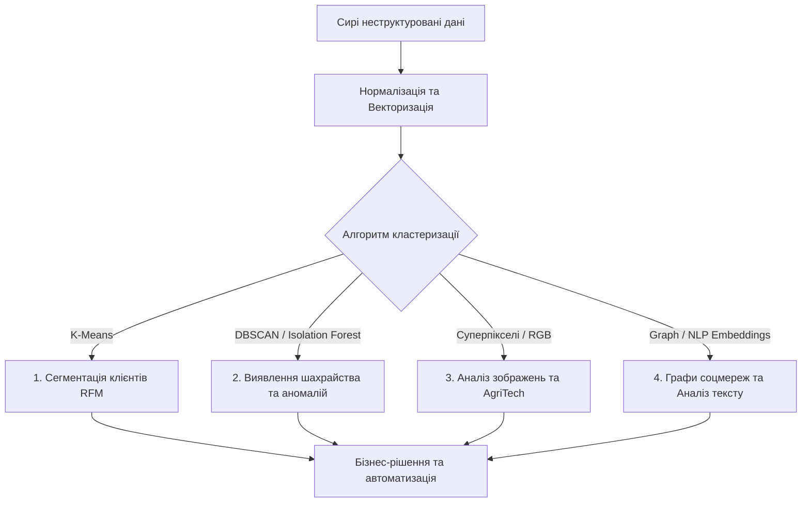
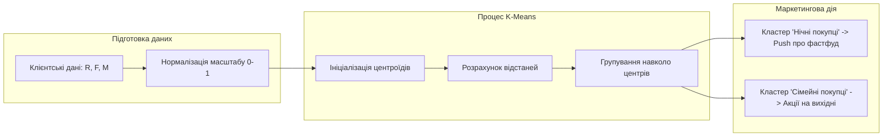
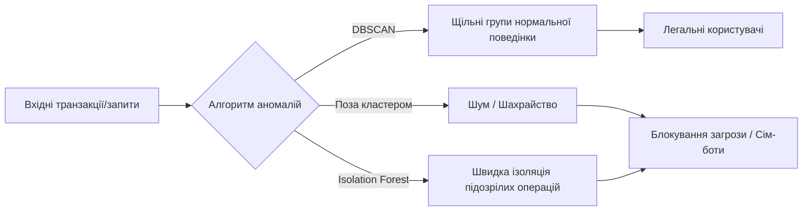
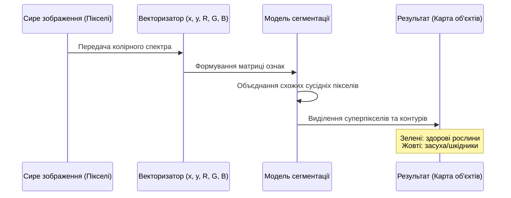
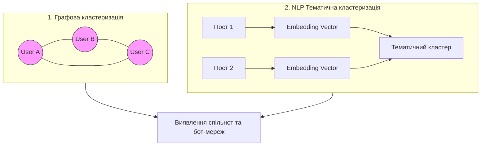

# Кластеризація в машинному навчанні: Від хаосу даних до чітких рішень

**Кластеризація** — це потужний інструмент машинного навчання без учителя (*Unsupervised Learning*), який дозволяє автоматично групувати схожі об'єкти без попередньої розмітки даних. Вона є фундаментальним методологічним підходом для аналізу Big Data у найрізноманітніших галузях: від ритейлу та фінансів до комп'ютерного зору й кібербезпеки.

---

## Загальна архітектура застосування кластеризації

---

## 1. Сегментація клієнтів (RFM): Як це працює зсередини

### Механіка аналізу даних

1. **Збір показників:** Для кожного клієнта формуються три ключові параметри:
   * **R (Recency):** Кількість днів від останньої покупки (*чим менше значення, тим вища лояльність*).
   * **F (Frequency):** Кількість покупок за обраний період (наприклад, за рік).
   * **M (Monetary):** Загальна сума витрачених коштів.

2. **Нормалізація даних:** Оскільки фінансові показники вимірюються тисячами, а кількість покупок — одиницями, дані приводять до єдиного масштабу (наприклад, $0$–$1$). Це гарантує рівноцінний вплив кожного параметра на підсумкову групу.

3. **Кластеризація (K-Means):** Алгоритм шукає «центри тяжіння» (центроїди) і групує покупців навколо них за мірою геометричної близькості.

### Практична цінність для бізнесу

* **Точковий маркетинг:** Замість неефективного масового спаму компанія розробляє 3–5 узгоджених кампаній для різних сегментів.
* **Приклад з ринку:** Сервіси доставки (на кшталт *Glovo* чи *Liki24*) виділяють кластер «нічних покупців» і надсилають їм push-повідомлення у вечірній час із пропозиціями фастфуду. Натомість для кластера «сімейних покупців» формують акції на товари для дому у вихідні дні.

---

## 2. Виявлення шахрайства: Механіка знаходження аномалій

### Основні типи алгоритмів для виявлення аномалій

* **DBSCAN (Density-Based Spatial Clustering):** Знаходить щільні області нормальної поведінки користувачів, а все, що знаходиться на значній відстані в «полі самотності», маркує як шум або потенційне шахрайство.
* **Isolation Forest (Ізоляційний ліс):** Відокремлює підозрілі операції суттєво швидше за інші класичні методи, оскільки аномальні дані відрізняються критично нетиповими характеристиками й легко виділяються на перших етапах розгалуження дерев.

### Додаткові сфери застосування

* **Телекомунікації:** Виявлення сім-ботів (ситуації, коли з однієї SIM-карти одночасно або серійно відправляються тисячі SMS).
* **Кібербезпека (Network Intrusion Detection):** Фіксація випадків, коли окремий комп'ютер починає надсилати нетипово велику кількість запитів на невідомі IP-адреси (DDoS-атаки або несанкціонований витік даних).

---

## 3. Аналіз зображень: Від колірних спектрів до комп'ютерного зору

### Покроковий процес сегментації

1. **Векторизація:** Кожен піксель описується координатами $(x, y)$ та значеннями колірного спектра ($RGB$) або інтенсивністю сірого.
2. **Групування:** Алгоритм об'єднує сусідні пікселі з близьким кольором чи текстурою в єдині регіони («суперпікселі»).
3. **Виділення контурів:** Об'єднані сегменти формують чіткі межі об'єктів для подальшої обробки нейромережами.

### Передові практичні кейси

* **Агротехнології (AgriTech):** Супутники або дрони роблять мультиспектральні фото полів. Кластеризація за кольоровим спектром дозволяє миттєво визначити:
  * Де рослини здорові (**зелені кластери**).
  * Де спостерігається засуха чи пошкодження шкідниками (**жовті та бурі кластери**).
* **Супутникові карти (Google Maps):** Автоматичне розпізнавання зон лісу, водойм, житлових кварталів та транспортних артерій на космічних знімках.

---

## 4. Аналіз соціальних мереж: Графи та аналіз тексту (NLP)

### Два підходи до кластеризації у соцмережах

1. **Кластеризація за графами зв'язків (Graph Clustering):**
   * Соціальна мережа моделюється як граф із вузлами (користувачі) та ребрами (зв'язки між ними).
   * Алгоритми виявляють «спільноти» (*communities*) — щільно пов'язані групи людей зі спільними інтересами чи регулярною взаємодією.

2. **Тематична кластеризація контенту (Topic Modeling):**
   * Пости чи коментарі перетворюються на векторні представлення (*Embeddings*).
   * Алгоритми (*K-Means*, *HDBSCAN*) групують схожі за змістом тексти без попереднього знання тематики.

### Додаткові приклади

* **Аналіз тональності (Sentiment Analysis):** Бренди кластеризують відгуки клієнтів на три основні групи: *позитивні*, *нейтральні* та *критичні* для оперативного реагування на негатив.
* **Боротьба з дезінформацією:** Виявлення бот-мереж, які синхронно публікують однакові або семантично дубльовані тексти на різних акаунтах.

---

## Підсумок / Висновок

* **Універсальність методу:** Кластеризація є одним із найпотужніших інструментів аналізу даних, оскільки вона дозволяє виявляти приховані структури й закономірності в сирих даних без потреби у вартісній та тривалій попередній розмітці.
* **Практична цінність для бізнесу та безпеки:**
  * *У маркетингу (RFM):* Перетворює абстрактну базу клієнтів на чіткі сегменти, підвищуючи ефективність продажів та конверсію.
  * *У фінансах та кібербезпеці:* Працює як превентивний щит, миттєво виявляючи аномалії та загрози.
* **Технологічний прогрес:**
  * *У комп'ютерному зорі:* Забезпечує основу для автономного транспорту, супутникового моніторингу та точної медичної діагностики.
  * *У соцмережах та NLP:* Допомагає структурувати мільйони думок, будувати персоналізовані рекомендації та протидіяти дезінформації.

> **Головний висновок:** Кластеризація перетворює хаотичні масиви даних (*Big Data*) на зрозумілі бізнес-рішення. Вона дозволяє автоматизувати аналітику, підвищити безпеку систем та надавати користувачам саме той контент і сервіс, якого вони потребують у конкретний момент.